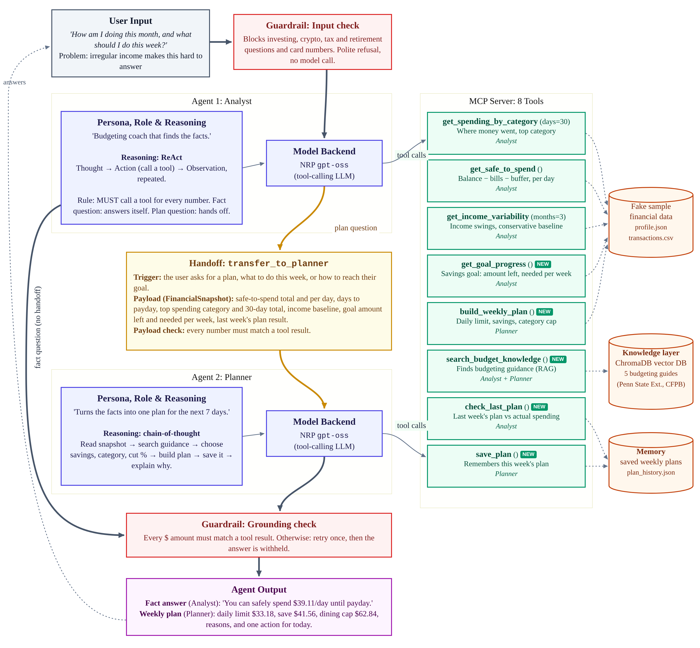

# BudgetWise AI (Team 3, CEN 4930 M3)

**Problem:** People with irregular income, particularly students and part-time workers, can check their balance but cannot tell how much money they can safely spend before their next paycheck, or what to change this week to stay on track.

## What the system does now
BudgetWise is now a **two-agent system** on the National Research Platform (NRP) `gpt-oss` model. It uses a custom Model Context Protocol (MCP) server for all money math, a **ChromaDB knowledge base** of budgeting guidance, and a small **memory** of past weekly plans. It runs on fake sample data in `data/`.

| | Agent 1: Analyst | Agent 2: Planner |
|---|---|---|
| **Role** | Finds the facts with tools. Answers fact questions itself ("How much can I spend per day?"). | Turns the facts into one concrete plan for the next 7 days. |
| **Reasoning** | **ReAct**: Thought, then Action (call one tool), then Observation, repeated until it has the facts. | **Chain-of-thought**: six fixed steps (read the snapshot, search guidance, choose save amount, category and cut %, build the plan, save it, explain why). |
| **Tools (MCP)** | `get_spending_by_category`, `get_safe_to_spend`, `get_income_variability`, `get_goal_progress`, `check_last_plan`, `search_budget_knowledge` | `search_budget_knowledge`, `build_weekly_plan`, `save_plan` |

**Handoff.** When the user asks for a plan ("what should I do this week?", "how do I reach my goal?"), the Analyst gathers five facts and calls `transfer_to_planner`. The payload is a typed `FinancialSnapshot`: safe-to-spend total and per day, days to payday, top discretionary category and its 30-day total, income baseline, goal remaining and needed per week, and the last-plan result. The payload's numbers are checked against the tool results, then the payload is placed in the Planner's instructions. Fact questions never hand off.

**Knowledge layer.** `knowledge/` holds 5 short guides based on Penn State Extension and CFPB advice. They are split into 20 passages and stored in a local ChromaDB vector database. Both agents reach it through the `search_budget_knowledge` MCP tool. The index rebuilds automatically when a guide changes.

**Memory.** `save_plan` stores each weekly plan in `memory/plan_history.json`. `check_last_plan` compares the earlier plan with what was actually spent: daily average vs. the daily limit, and the focus category vs. its cap.

**Guardrails.**
1. **Input guardrail** on the Analyst blocks investing, crypto, tax and retirement questions, and card numbers, account numbers or passwords. The question never reaches the model.
2. **Payload check** at the handoff.
3. **Grounding output guardrail** on both agents: every `$` amount in the answer must match a tool result to the cent. If one doesn't, the system retries once with a correction note. If that fails too, the answer is withheld.

## Setup and run
1. Install Python 3.11 or newer. If `chromadb` fails to install on the newest Python, use Python 3.12.
2. `git clone https://github.com/erFig/TeamProject3_M3.git` and `cd TeamProject3_M3`
3. Create and activate a virtual environment: `python -m venv venv`, then `venv\Scripts\activate` (Windows) or `source venv/bin/activate`
4. `python -m pip install -r requirements.txt`
5. Copy `.env.example` to `.env` and paste your NRP token. Never commit `.env`.
6. Run it:
   - Plan (handoff): `python agent.py "How am I doing this month, and what should I do this week?"`
   - Fact (no handoff): `python agent.py "How much can I safely spend per day until my next paycheck?"`
   - Chat mode: `python agent.py`. Add `--quiet` to hide the step log or `--trace` for SDK spans.
   - Forget saved plans: `python agent.py --reset-memory`

The first run downloads ChromaDB's small embedding model (about 80 MB) once.

## Tests
- `python -m pytest`: 31 checks with no LLM. Exact tool math, both guardrails, the payload check, the knowledge search, and all 8 tools through the real MCP protocol.
- `python tests/run_agent_tests.py`: the 10 live test cases in `tests/test_cases.md`, judged on route, tools called, expected figures and grounding. It writes `tests/results/latest_results.md`. First full run: **10/10 passed**.

## CHANGES (since M2)
| Added / changed | Why |
|---|---|
| Split the single agent into **Analyst** and **Planner** with an explicit `handoff()` and typed `FinancialSnapshot` payload | M2 only reported numbers. Our M1 interviewees asked for personalized guidance, not just balances. Separating "find facts" from "make a plan" gives each agent one clear job. |
| **ReAct** instructions for the Analyst and **chain-of-thought** steps for the Planner, plus a live step log (Thought, Action, Observation, handoff) | Makes the reasoning visible and repeatable, and shows *why* a plan was chosen. |
| **ChromaDB knowledge base** (`knowledge/`, `search_budget_knowledge`) | Advice was generic in M2. Now it comes from cited sources the agents retrieve. |
| New MCP tools: `get_goal_progress`, `build_weekly_plan`, `save_plan`, `check_last_plan` | The Planner chooses the strategy, and Python does every calculation. This keeps the M2 rule that the LLM never does money math. |
| **Plan memory** with a sample earlier plan (`data/plan_history_seed.json`) | Lets the system check in week to week ("did I stick to last week's plan?"). |
| Sample savings goal in `data/profile.json` | Gives the Planner something to plan toward. |
| **Guardrails** in `guardrails.py`: input scope and privacy, handoff payload check, grounding output guardrail with one retry | Trust was the biggest market risk in our M2 report. Out-of-scope questions are refused, and no unverified number reaches the user. |
| Tests: 3 to **10 live cases**, plus unit tests for every new tool and guardrail; results table | Gives the evaluation plan for M4 something to run. |
| `requirements.txt`: `chromadb`, `pydantic`; `.gitignore`: `chroma_db/`, `memory/` | New dependencies; local state stays out of git. |

## Intentionally not built yet
Real bank data import, investing, tax or retirement guidance, multiple users and accounts, a web or mobile UI, and an LLM critic agent for evaluation (planned for M4).

## Known limitations
1. **The plan's category cap can be looser than last week's.** `build_weekly_plan` sets the cap from the 30-day average, not from the previous cap. In testing, the Planner called a $62.84 dining cap "tighter" even though last week's cap was $60.00.
2. **Frozen sample data.** "Today" is always 2026-09-28, so "last week" is always the same 7 days, and new plans start on the same date.
3. **The input guardrail uses keywords.** It can block harmless questions that mention a blocked word (e.g. "sales tax"), and it can miss reworded ones.
4. **gpt-oss is not perfectly consistent.** Wording and the Planner's choices can vary between runs, and it may round numbers. The grounding guardrail catches rounded or invented dollar amounts, but not wrong percentages or dates.
5. **Memory is a local JSON file** for one user. It isn't shared across devices.
